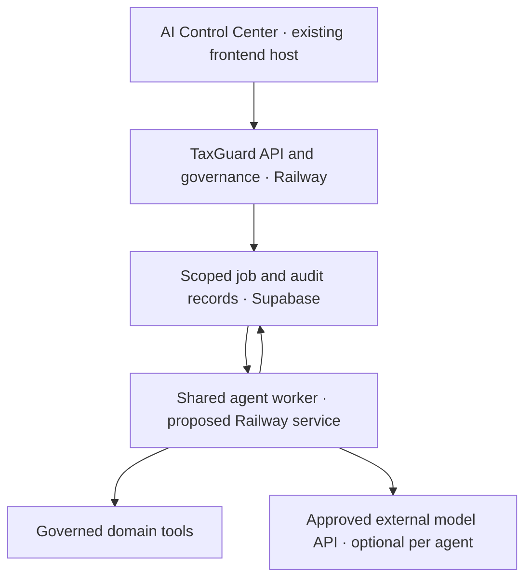
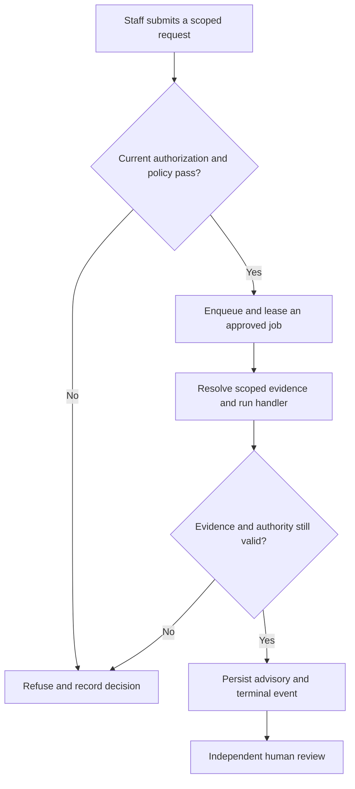

# TaxGuard AI workforce architecture

This document records the A00–A60 application-agent design, local implementation, and release boundaries. The existing Architecture Overview transcription is the source for planned roles and human gates. The deployment registry and server governance determine runtime authority.

## Hosting and ownership

GitHub `main` is the source of truth for application code, tests and reviewed configuration. Use distinct staging and production Railway services and Supabase projects. The worker is a proposed private backend service, with approval and scoped credentials required before hosted validation. A10 duplicate matching is deterministic and requires no model.

## Request and evidence flow

Resolve the current actor, tenant, client, case, tax year, stage, agent grant and approved capability on the server. Recheck time-sensitive policy, evidence and kill switches before recording a result. A00 coordinates within approved routes. Child agents require independent authorization. Keep session tokens, taxpayer documents and provider secrets out of queue payloads and shared knowledge. Version approved reference material and filter retrieval by scope, jurisdiction, tax year and effective date.

## Implementation and verification

| Area | Evidence |
| --- | --- |
| Control Center roster | Local application integration joins all 61 planned roles with commissioning status and implementation scope. |
| Bounded local handlers | A00 orchestration, A10 duplicate-document checking and A34 review support have limited local evidence. |
| A10 durable branch | Draft code partitions AI and ordinary job claims, checks the selected synthetic evidence twice, and persists a review-required duplicate-group count and terminal event in one fenced transaction. |
| Local verification | TypeScript and production build passed. Focused AI suite passed 320 tests. Disposable PostgreSQL suite passed 18 tests. The build emitted a bundle-size warning. |
| Hosted status | No hosted worker, live governed resolver, approved migration, or staging acceptance. All 61 deployment entries are DRAFT. |

See the [rehearsal commands and implementation notes](ai-workforce-rehearsal.md), [SQL review draft](sql/ai-advisory-job-draft.sql), and [reconciliation and owner decisions](ai-architecture-overview-reconciliation.md).

## Remaining specialist gaps

A09 has a local manifest evaluator. Its hosted route, current authorization resolver and review queue integration are open. A00, A10 and A34 have bounded local routing or handler evidence. The other 57 entries have no specialist implementation evidenced by this development block.

| Groups | Dependency before expanding |
| --- | --- |
| A01–A08, A11 | Durable intake, identity and evidence contracts with scoped authorization and fixtures. |
| A12–A31 | Approved accounting and tax source versions, calculation provenance and independent review. |
| A32–A42 excluding A34 | Exception and review contracts, human-controlled signing and filing, and an owner definition for A39. |
| A43–A60 | Scoped drafts and operational signals, with human control over communications, payments and administration. |

## Development sequence

1. Review and integrate the roster changes with exact-commit CI evidence.
2. Bind the A10 evidence resolver to live governance, including atomic policy acceptance and a scoped review read path. Review the SQL before adding it to the migration manifest.
3. Validate the worker on isolated Railway and Supabase staging with synthetic cases. Cover stale leases, retries, cancellation, audit durability, actor and case isolation, provider limits where applicable, and rollback.
4. Implement specialist agents in groups. For each ID, approve responsibility, inputs, schema, scope, tools, reviewer, test fixtures, and operational limits.
5. Commission individually using recorded staging evidence and explicit approval. Keep merge, deployment, hosted SQL, provider configuration and production setting changes individually gated.

## Design roster

A21 uses the Overview's Individual Tax Agent designation pending reconciliation of the implementation directive. A39 has no assigned individual responsibility or human gate in the Overview. A10's current scope is duplicate-hash checking over selected authorized evidence. The design gate column records the source labels and does not grant runtime authority.

| ID | Design name | Planned responsibility | Design gate |
| --- | --- | --- | --- |
| A00 | Supervisor / Orchestrator Agent | Routes work between agents, workflows and stages | Yes (material) |
| A01 | Client Onboarding Agent | Guides onboarding and detects missing information | Staff |
| A02 | Identity Verification Agent | Reviews identity evidence and inconsistencies | Staff |
| A03 | Engagement Agent | Determines required engagement workflow | Staff |
| A04 | Tax Organizer Agent | Intelligent taxpayer questionnaire | Preparer |
| A05 | Document Intake Agent | Controls incoming documents | Staff |
| A06 | Document Classification Agent | Classifies W-2, 1099, K-1, receipts, etc. | Reviewer |
| A07 | OCR Extraction Agent | Extracts structured fields | Reviewer |
| A08 | Document Validation Agent | Checks extracted info against source | Reviewer |
| A09 | Missing Document Agent | Identifies missing evidence | Staff |
| A10 | Duplicate/Fraud Indicator Agent | Bounded duplicate-hash check | Unassigned |
| A11 | Evidence Agent | Builds evidence chains | Preparer |
| A12 | Bookkeeping Agent | Suggests transaction classifications | Accountant |
| A13 | Reconciliation Agent | Identifies reconciliation differences | Accountant |
| A14 | Journal Entry Agent | Proposes journal entries | Accountant |
| A15 | Financial Statement Agent | Analyzes P&L, balance sheet, cash flow | Accountant |
| A16 | Book-to-Tax Agent | Identifies accounting/tax differences | Tax professional |
| A17 | Tax Research Agent | Researches applicable tax rules | CPA/EA |
| A18 | Federal Tax Agent | Analyzes federal tax treatment | Preparer/CPA |
| A19 | State Tax Agent | Determines state issues | Preparer/CPA |
| A20 | Entity Tax Agent | LLC, partnership, S-Corp, C-Corp | CPA/EA |
| A21 | Individual Tax Agent | Individual return analysis | Preparer |
| A22 | Deduction Agent | Identifies deductions | Preparer |
| A23 | Credit Agent | Identifies credits | Preparer |
| A24 | Depreciation Agent | Asset/depreciation treatment | Preparer |
| A25 | Payroll Tax Agent | Payroll-related analysis | Professional |
| A26 | Estimated Tax Agent | Projects estimated payments | Professional |
| A27 | Tax Planning Agent | Scenario and planning analysis | CPA/EA |
| A28 | Tax Calculation Verification Agent | Checks deterministic outputs | Reviewer |
| A29 | Return Preparation Agent | Coordinates return assembly | Preparer |
| A30 | Form Mapping Agent | Maps validated info to tax forms | Preparer |
| A31 | Return Diagnostics Agent | Detects incomplete/inconsistent returns | Reviewer |
| A32 | Exception Agent | Creates and routes exceptions | Reviewer |
| A33 | Risk & Materiality Agent | Scores material risks | CPA/EA |
| A34 | Reviewer Agent | AI-assisted second-level review | Human reviewer |
| A35 | Quality-Control Agent | Independent final QC | CPA/EA |
| A36 | Signature Readiness Agent | Verifies prerequisites before signature | Staff |
| A37 | Filing Readiness Agent | Determines if filing gates satisfied | Authorized filer |
| A38 | Filing Agent | Coordinates approved submission | Explicit authorization |
| A39 | Government Response Agent | Unassigned | Unassigned |
| A40 | Rejection Resolution Agent | Diagnoses rejected filings | Preparer |
| A41 | Tax Notice Agent | Classifies government notices | CPA/EA |
| A42 | Amendment Agent | Identifies amendment workflow | CPA/EA |
| A43 | Client Communication Agent | Drafts client communications | Staff |
| A44 | Appointment Agent | Coordinates appointments | Staff / client |
| A45 | Task Agent | Creates workflow tasks | Policy-controlled |
| A46 | Deadline Agent | Tracks filing/payment deadlines | Staff |
| A47 | Billing Agent | Assists billing/invoice workflows | Authorized staff |
| A48 | Payment Reconciliation Agent | Matches payments to invoices | Accounting |
| A49 | Archive Agent | Checks completeness before archival | Staff |
| A50 | Renewal Agent | Prepares next-year engagement | Staff |
| A51 | Audit Trail Agent | Detects missing/abnormal audit events | Compliance |
| A52 | Compliance Agent | Evaluates workflow-policy compliance | Compliance officer |
| A53 | Privacy Agent | Detects sensitive-data handling issues | Security/compliance |
| A54 | Security Agent | Monitors suspicious activity | Security/admin |
| A55 | Access-Control Agent | Reviews RBAC/RLS anomalies | Admin |
| A56 | AI Governance Agent | Monitors model use, prompts and AI decisions | Admin/compliance |
| A57 | Hallucination/Verification Agent | Challenges unsupported AI conclusions | Human review |
| A58 | System Health Agent | Monitors services and integration health | Admin |
| A59 | Provider Integration Agent | Monitors external provider connectivity | Admin |
| A60 | Practice Intelligence Agent | Operational analytics and workload analysis | Management |
